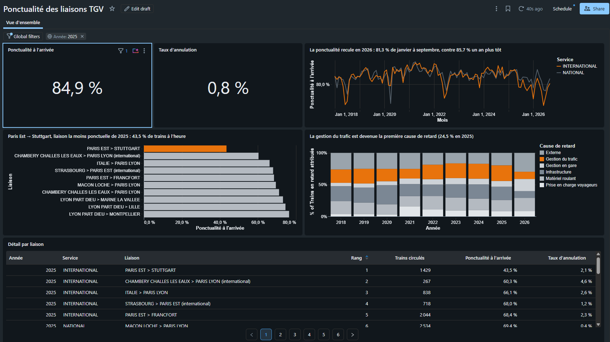
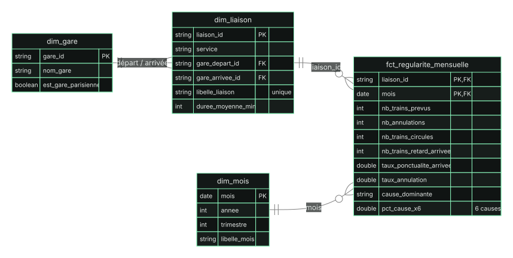
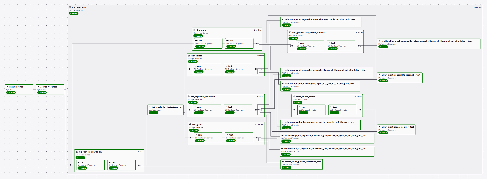

# Rail Lakehouse : ponctualité des TGV avec dbt et Databricks

[](https://github.com/shakiroye/rail-lakehouse/actions/workflows/ci.yml)
[](https://shakiroye.github.io/rail-lakehouse/)
[](https://shakiroye.github.io/rail-lakehouse/)
[](https://opendatacommons.org/licenses/odbl/)

> Pipeline de bout en bout qui ingère l'open data SNCF, le modélise en schéma en étoile avec dbt sur Databricks,
> le teste automatiquement et l'expose dans un dashboard de ponctualité.

**La question métier :** quelles liaisons TGV sont les moins ponctuelles, et pourquoi ?



## Ce que le projet montre

Trois constats tirés des données (détail et méthode dans [`docs/insights.md`](docs/insights.md)) :

1. **Paris Est → Stuttgart s'est effondrée** : 43,5 % de trains à l'heure en 2025 contre 81,1 % en 2024 (-37,6 points),
   la plus forte dégradation de l'année. Les causes externes expliquent 75 % de ses retards.
2. **La gestion du trafic est devenue la première cause de retard** : 24,5 % des retards en 2025, contre 23,2 % (3ᵉ rang) en 2019.
   La prise en charge des voyageurs a plus que doublé (3,7 % → 8,0 %).
3. **2026 est la pire année de la série** : 81,3 % de ponctualité de janvier à septembre, contre 85,7 % sur la même période en 2025.
   L'international décroche (76,5 %), alors qu'il faisait mieux que le national en 2024.

Taux pondérés par le nombre de trains, calculés par liaison : ce ne sont pas les taux de ponctualité officiels du TGV
(la fiche de la source l'interdit, voir [Limites](#limites-et-pistes-damélioration)).

## Architecture



| Brique | Outil | Pourquoi ce choix |
| --- | --- | --- |
| Stockage et calcul | Databricks Free Edition (Unity Catalog, Delta Lake, SQL Warehouse serverless) | Le produit utilisé en entreprise, gratuit et sans carte bancaire |
| Ingestion | Python (`requests`, Databricks SDK, connecteur SQL) | Free Edition limite l'accès Internet sortant : le téléchargement se fait hors de Databricks |
| Transformation | dbt Core 1.12 + dbt-databricks 1.13 | Standard du marché pour la couche T de l'ELT : SQL versionné, testé, documenté |
| Qualité | Tests dbt, dbt_utils, dbt_expectations, tests unitaires, fraîcheur de source | La donnée fausse est arrêtée avant d'atteindre le dashboard |
| Orchestration | Apache Airflow 3 (Astro CLI, Docker) + Astronomer Cosmos | Chaque modèle dbt devient une tâche visible, relançable seule, suivie de ses tests |
| Restitution | Databricks AI/BI Dashboard | Intégré au lakehouse, lit uniquement la couche gold |
| CI/CD | GitHub Actions, SQLFluff, dbt docs sur GitHub Pages | Une PR ne passe que si les tests, le lint et le `dbt build` sont verts |

## Modèle de données

Schéma en étoile dans `gold`, alimenté par une couche `silver` qui est la seule porte d'entrée vers la source.



| Modèle | Couche | Matérialisation | Grain |
| --- | --- | --- | --- |
| `stg_sncf__regularite_tgv` | silver | vue | mois × service × liaison (dernier instantané) |
| `int_regularite__indicateurs` | silver | ephemeral | mois × liaison : clés et indicateurs calculés une fois |
| `dim_gare`, `dim_liaison`, `dim_mois` | gold | table | gare, liaison, mois |
| `fct_regularite_mensuelle` | gold | **incrémental (merge)** | mois × liaison |
| `mart_ponctualite_liaison_annuelle` | gold | table | année × liaison, avec classement |
| `mart_causes_retard` | gold | table | mois × liaison × cause |

**[Documentation dbt en ligne, avec le lineage cliquable](https://shakiroye.github.io/rail-lakehouse/)** : chaque modèle et chaque colonne y est décrit.

## Qualité de données

**71 tests** (69 tests de données et 2 tests unitaires), plus un contrôle de fraîcheur de la source, répartis sur 5 niveaux :

| Niveau | Exemples |
| --- | --- |
| Fraîcheur de la source | Avertissement après 35 jours sans chargement, erreur après 45 |
| Contraintes de base | `unique`, `not_null`, `relationships` des faits vers les 3 dimensions, `accepted_values` |
| Règles métier | Causes entre 0 et 100 et sommant à 100 ; taux entre 0 et 1 ; seuils de retard cohérents (> 60 ≤ > 30 ≤ > 15 min) |
| Réconciliation | Mêmes totaux de trains entre staging, faits et mart annuel ; 6 lignes de causes par ligne de faits |
| Logique de calcul | Tests unitaires dbt : division par zéro (liaison entièrement annulée), cause dominante (égalités, causes manquantes) |

**`error` ou `warn` ?** Un défaut qui fausserait le modèle (clé dupliquée, jointure orpheline, taux hors bornes) est en `error` et bloque le pipeline.
Une anomalie connue de la source, qu'on ne peut pas corriger, est en `warn` : elle reste visible sans bloquer.
Les lignes fautives sont conservées dans un schéma `_dq` pour analyse.

```text
Done. PASS=72 WARN=6 ERROR=0 SKIP=0 NO-OP=0 REUSED=0 TOTAL=78
```

Les 6 avertissements correspondent exactement aux anomalies relevées pendant l'[exploration de la source](docs/exploration.md)
(confinement de 2020, causes manquantes de mi-2018, colonne « retard > 30 min » inexploitable au premier trimestre 2025…).

## Orchestration

Un DAG Airflow mensuel (le 5 de chaque mois, après la publication SNCF) : ingestion bronze, contrôle de fraîcheur,
puis les modèles dbt rendus par Cosmos, avec une tâche `run` et une tâche `test` par modèle.
Les tests qui dépendent de plusieurs modèles (réconciliations, `relationships`) sont des tâches à part, lancées une fois tous leurs parents construits.



## CI/CD

- **Sur chaque pull request** : tests Pytest de l'ingestion, lint SQLFluff, `dbt build` complet dans des schémas propres à la PR
  (`ci_pr_<n>_silver`, `ci_pr_<n>_gold`…), puis suppression de ces schémas, même en cas d'échec.
- **Sur `main`** : la documentation dbt est régénérée et publiée sur GitHub Pages.
- **`main` est protégée** : PR et CI verte obligatoires. Une [PR qui casse volontairement un test](https://github.com/shakiroye/rail-lakehouse/pull/2)
  a été bloquée : dbt a sauté les 46 étapes en aval, la donnée fausse n'a jamais atteint `gold`.

## Choix techniques et arbitrages

- **Ingestion locale plutôt que dans Databricks** : Free Edition limite l'accès Internet sortant à des domaines de confiance.
- **Bronze 100 % texte** : tout est chargé en `STRING`, le typage se fait en staging. Un changement de format côté source ne casse pas l'ingestion.
- **Idempotence** : un fichier daté par exécution et `COPY INTO`, qui mémorise les fichiers déjà chargés. Relancer ne crée aucun doublon.
- **CSV multiligne** : les commentaires de la source contiennent des retours à la ligne. Sans `multiLine`, la table bronze aurait compté 15 424 lignes au lieu de 12 907 ;
  un contrôle compare désormais le nombre de lignes chargées au nombre d'enregistrements du fichier.
- **Dernier instantané plutôt que déduplication ligne à ligne** : chaque fichier contient tout l'historique. Le plus récent fait foi :
  une ligne corrigée ou retirée par la SNCF est prise en compte, ce qu'un `row_number()` par clé ne ferait pas.
- **Incrémental `merge` avec fenêtre glissante de 3 mois** : la SNCF corrige parfois les derniers mois publiés. `--full-refresh` reconstruit tout.
- **Environnements isolés** : une macro de nommage envoie le dev dans `dbt_dev_*`, la CI dans `ci_pr_<n>_*` et la prod dans `silver` / `gold`.
  La macro de nettoyage de la CI refuse de toucher à un schéma qui ne commence pas par `ci`.
- **Jamais de moyenne de taux** : les marts et le dashboard calculent `somme des retards / somme des trains`, quel que soit le filtre.
- **Libellés uniques** : un même trajet peut exister en national et en international. Le libellé de la version internationale est suffixé,
  et un test `unique` l'impose : le défaut n'était visible que dans un graphique groupé par libellé.

## Chiffres clés

| | |
| --- | --- |
| Lignes par instantané | 12 907 (146 liaisons, 59 gares, 105 mois de 2018-01 à 2026-09) |
| Modèles dbt | 8 |
| Tests | 71, plus la fraîcheur de source |
| Durée du DAG complet | environ 4 minutes, 27 tâches |
| Durée de la CI | environ 3 minutes |
| Coût mensuel | 0 € (Databricks Free Edition, GitHub Actions et Pages gratuits) |

## Lancer le projet

Prérequis : Python 3.12+, Docker, [Astro CLI](https://www.astronomer.io/docs/astro/cli/install-cli), un compte
[Databricks Free Edition](https://docs.databricks.com/aws/en/getting-started/free-edition) et le script [`setup/00_init.sql`](setup/00_init.sql) exécuté dans son éditeur SQL.

```bash
cp .env.example .env                       # renseigner l'hôte, le HTTP path du SQL Warehouse et un token Databricks
pip install -r requirements-dev.txt
python -m include.ingestion.sncf           # ingestion vers bronze
cd include/dbt && dbt deps && dbt build --profiles-dir .   # dbt en dev (variables du .env chargées dans le shell)
astro dev start                            # Airflow sur http://localhost:8080, DAG rail_lakehouse
```

Le dashboard se réimporte depuis [`dashboards/ponctualite_tgv.lvdash.json`](dashboards/ponctualite_tgv.lvdash.json)
(il n'est pas public : Databricks Free Edition ne permet pas le partage hors de l'espace de travail).

<details>
<summary>Structure du repo</summary>

```text
rail-lakehouse/
├── dags/rail_lakehouse_dag.py       # DAG Airflow (ingestion -> fraîcheur -> dbt via Cosmos)
├── include/
│   ├── ingestion/sncf.py            # ingestion bronze
│   └── dbt/                         # projet dbt : modèles, tests, macros, profiles.yml sans secret
├── dashboards/                      # définition du dashboard AI/BI
├── notebooks/01_exploration.ipynb   # exploration de la source
├── docs/                            # exploration, insights, captures
├── setup/00_init.sql                # schémas bronze / silver / gold et volume
├── tests/                           # Pytest : ingestion et intégrité des DAGs
└── .github/workflows/               # CI et publication de la doc
```

</details>

## Limites et pistes d'amélioration

**Limites**

- La source décrit la régularité **par liaison** : un même train peut être compté sur plusieurs liaisons. Sa fiche interdit d'en tirer
  un taux de ponctualité global du TGV ou par axe, publié par la SNCF dans d'autres jeux. Les agrégats du projet restent donc des indicateurs par liaison.
- La part des retards de plus de 30 minutes n'est pas fiable de janvier à mars 2025 (défaut de la source).
- Avril à juin 2020 sont atypiques (confinement) ; 2026 est une année partielle.

**Pistes**

- Slim CI : ne construire en PR que les modèles modifiés et leurs dépendants (`state:modified+`).
- Deuxième source : le référentiel des gares (coordonnées, région) pour enrichir `dim_gare` et ajouter une carte.
- Snapshot SCD de type 2 sur `dim_liaison` pour historiser les durées de trajet.
- Contrats de modèles dbt sur les tables `gold`.
- Alerting Slack ou Discord sur l'échec du DAG.

## Source des données et licence

Données : [Régularité mensuelle TGV par liaisons](https://www.data.gouv.fr/datasets/regularite-mensuelle-tgv-par-liaisons),
AQST / SNCF, publiées sous [licence ODbL](https://opendatacommons.org/licenses/odbl/).
